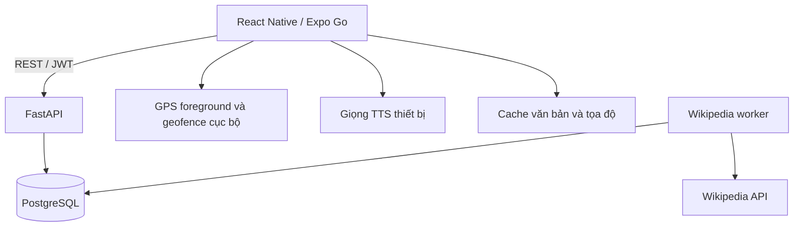
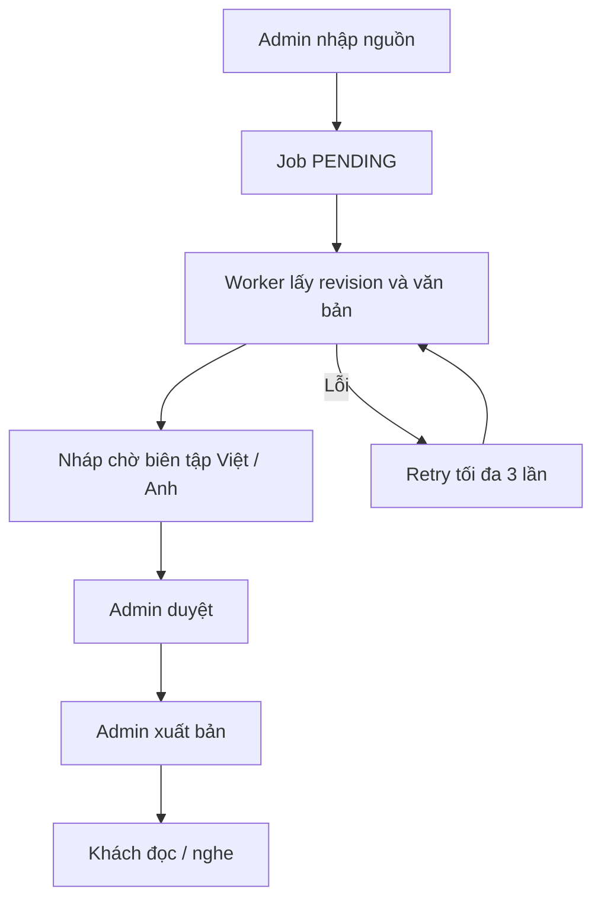

# Kiến trúc bản Expo pilot

Luồng khách không gửi stream GPS lên backend. POI published được tải về, so khoảng cách cục bộ và phát voice trên thiết bị.

Bản nháp immutable theo hướng tạo bản mới cho mỗi lần lưu. POI chỉ giữ con trỏ published_version; sửa nháp không đổi nội dung công khai. Bản seed demo là ngoại lệ được đánh dấu rõ, không có human review thật.

## Bảng dữ liệu

| Bảng | Mục đích |
|---|---|
| admins | Email unique, Argon2 password hash |
| pois | Tọa độ, radius, thông tin địa điểm, con trỏ bản xuất bản, archive |
| content_versions | Việt/Anh, trạng thái, metadata nguồn, người duyệt |
| jobs | Hàng đợi nhập Wikipedia, idempotency, attempts, lỗi, kết quả |
| consents | Hash token thiết bị, trạng thái và policy |
| analytics_events | Sự kiện bắt đầu/kết thúc, id chống trùng, không có GPS |
| audit_logs | Người thao tác, hành động và đối tượng |

## Mô hình bảo mật pilot

- Password hash Argon2, JWT HS256 hết hạn 8 giờ, khóa nằm backend.
- Token admin và consent lưu SecureStore, không AsyncStorage.
- Schema input giới hạn tọa độ, bán kính, độ dài và URL Wikipedia allowlist.
- Query SQL dùng SQLAlchemy bind parameters.
- Consent row khóa trong transaction khi thu hồi/nhận event, tránh nhận event sau thu hồi đã commit.
- API bind LAN để điện thoại truy cập; database chỉ expose localhost trong Compose.
- Trước khi đưa lên internet: HTTPS, shared rate limit, secret management, migration, backups và production tests.
