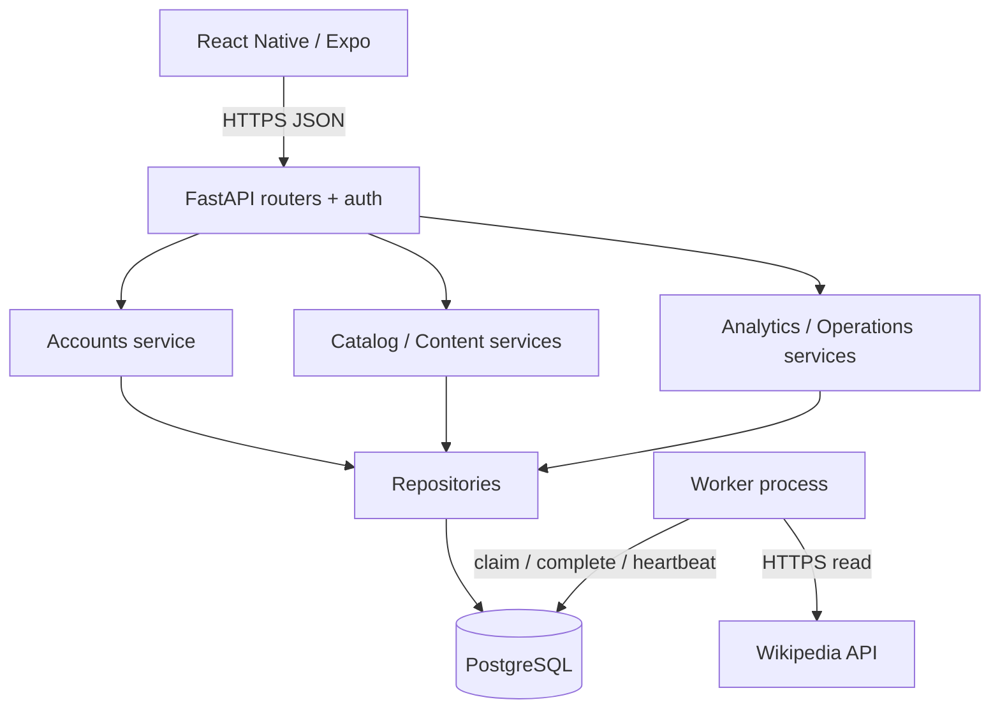
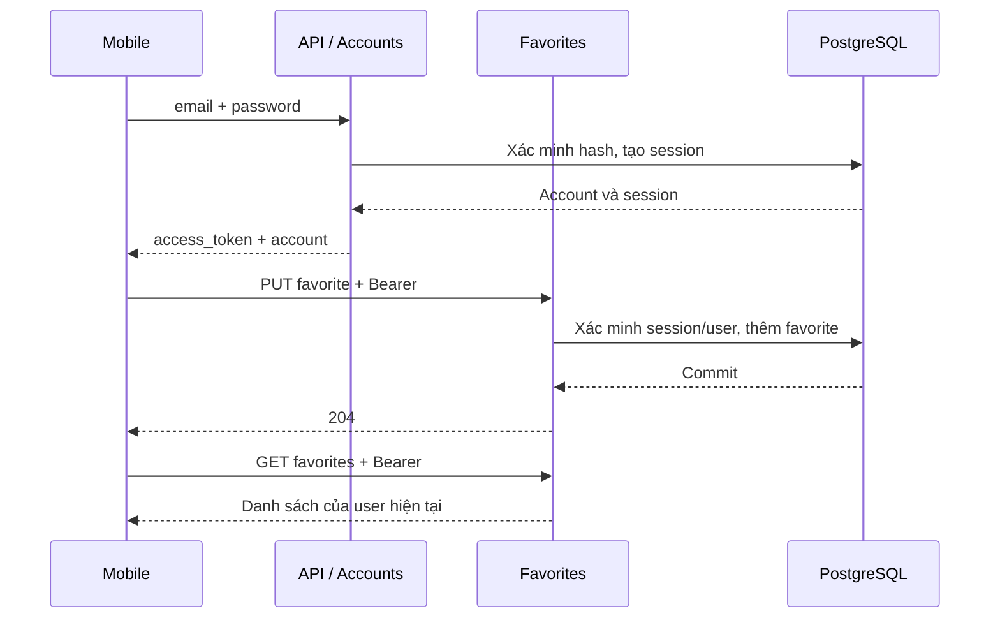
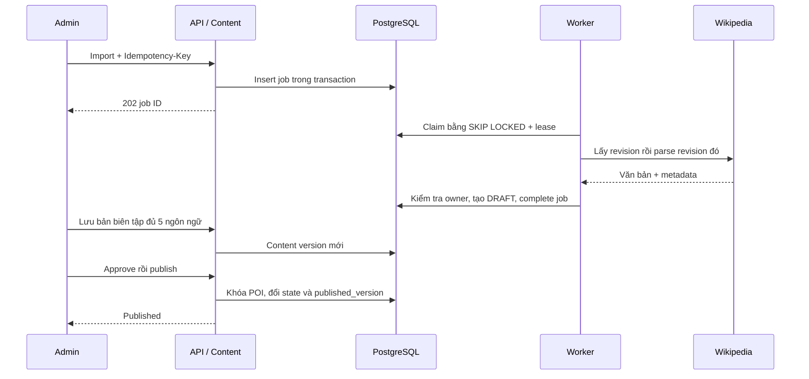
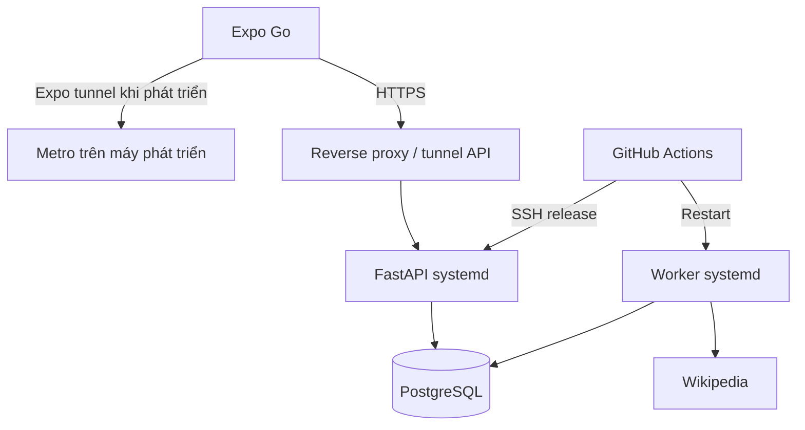

# Backend services và hợp đồng giao tiếp

Áp dụng cho bản 1.3 bổ sung BE/CI/CD. Backend là modular monolith FastAPI: các module nghiệp vụ gọi hàm Python, dùng repository để truy cập PostgreSQL. Worker là tiến trình độc lập, nhận việc qua PostgreSQL. Không dùng Docker. Mobile chỉ gọi API, không giữ thông tin kết nối database.

## Component

## Trách nhiệm và ranh giới

| Module | Đầu vào / đầu ra | Dữ liệu và transaction | Bảo vệ |
| --- | --- | --- | --- |
| Accounts | Đăng ký, đăng nhập, session, đổi mật khẩu → account/token hoặc lỗi | User/Admin/AuthSession; commit khi tạo/thu hồi phiên | Hash Argon2, role user/admin; đổi mật khẩu thu hồi phiên khác |
| Catalog | POIInput → POI; truy vấn công khai → nội dung published | POI và pointer published_version | Admin mới được sửa; public không đọc bản nháp |
| Content | DraftInput, version ID, Idempotency-Key → version/job ID | Content, Audit, Job; khóa POI khi publish | Đủ 5 bản có ≥20 ký tự để approve; human review trước publish |
| Favorites | User session + POI ID → danh sách ID / 204 | Favorite theo user | Không nhận user ID do client tự chọn; PUT/DELETE lặp lại an toàn |
| Analytics | Consent token + event → 202 | Consent/Event; thu hồi xóa sự kiện thuộc token | Không nhận GPS; chống event trùng theo ID |
| Operations | Health / admin request → checks, jobs, HTTP stats | Schema revision/checksum, heartbeat, jobs | /admin/operations cần admin; readiness có thể bắt buộc worker |
| Worker + queue repository | Job claim → source text/metadata → DRAFT | Claim transaction ngắn; fetch ngoài transaction; complete kiểm tra lease | SKIP LOCKED, owner token, lease, 3 lần thử, backoff |

## Hợp đồng HTTP

Đường dẫn bên dưới có prefix `/api/v1`, trừ `/health/ready`. Schema đầy đủ do code sinh tại `/openapi.json` và `/docs`. CI lưu `openapi.json` trong artifact backend; không xem bảng tóm tắt này là thay thế schema.

| Endpoint | Đầu vào / quyền | Kết quả chính |
| --- | --- | --- |
| POST /user-auth/register | email, name, password | 201 account + access_token |
| POST /user-auth/login; /auth/login | email, password; endpoint sau cho admin | 200 session |
| GET /session/me; POST /session/logout | Bearer token | 200 account; 204 revoked |
| POST /session/password | current_password, new_password + session | 200; giữ phiên hiện tại |
| GET /pois; /pois/{id} | Công khai | Danh sách / chi tiết published |
| POST /admin/pois | POIInput + admin | 201 POI |
| PUT /admin/pois/{id}; DELETE /admin/pois/{id} | admin | Cập nhật / lưu trữ |
| POST /admin/pois/{id}/import-wikipedia | admin + Idempotency-Key dài 8–100 ký tự | 202 job ID, state |
| GET /admin/jobs | admin | Trạng thái, attempt, lỗi, content_id |
| POST /admin/jobs/{id}/retry | admin; chỉ FAILED | Đưa lại vào PENDING |
| POST /admin/pois/{id}/drafts | vi/en/zh/fr/ja + admin | 201 version ID |
| POST /admin/content/{id}/approve; /publish | admin | 200 state; 409 nếu sai trạng thái |
| POST /admin/pois/{id}/unpublish | admin | 200; gỡ khỏi catalog công khai |
| GET /users/me/favorites; PUT/DELETE /users/me/favorites/{id} | user Bearer | Danh sách / 204 |
| POST /consent; POST /events | X-Consent-Token khi có | Consent/token; event 202 |
| GET /health/ready | Công khai | 200 ready hoặc 503; database/schema/worker |
| GET /admin/operations | admin | Job counts + metrics HTTP trong tiến trình |

401: phiên thiếu/hết hạn; 403: sai quyền/consent; 404: không tồn tại hoặc chưa published; 409: xung đột nghiệp vụ; 422: input không hợp lệ; 429: quá nhiều lần thử; 503: chưa sẵn sàng. Response có X-Request-ID để đối chiếu log. Không ghi password/token/body vào log.

## Đăng nhập và yêu thích

Mobile lưu token bằng SecureStore, gắn với origin API; không gửi token sang máy chủ mới. GET có thể retry một lần, mutation không tự gửi lại. Mất response mutation có thể có nghĩa server đã commit: tải lại trạng thái trước khi thao tác tiếp.

## Nhập bài và xuất bản

Job là hợp đồng bền vững: ID, poi_id, source_url, state, attempts, lease_owner, lease_until, content_id. Không giữ khóa database trong lúc gọi Wikipedia. Worker chết: lease hết hạn sẽ thu hồi; kết quả từ owner cũ bị bỏ. Nhập bài không tự dịch và không tự xuất bản.

## Deployment và giới hạn

Expo tunnel và API tunnel là hai kết nối riêng. Production cần URL HTTPS cố định; PostgreSQL không mở ra điện thoại. Chưa có Redis, broker ngoài, service discovery, AI dịch hay TTS server. Rate limit và metrics HTTP hiện theo một API process; cần shared limiter/metrics tập trung khi mở rộng nhiều instance.

## Truy vết kiểm thử

- `test_service_flow.py`: toàn bộ luồng import → worker → nháp → biên tập 5 ngôn ngữ → approve → publish → favorites → consent → logout → unpublish. Chỉ thay network Wikipedia bằng dữ liệu cố định; các service/repository/transaction chạy thật.
- `test_operations.py`: migration/schema/heartbeat/lease và native concurrency.
- `test_accounts.py`: phân quyền, cô lập favorites, thu hồi phiên và đổi mật khẩu.
- `test_release.py`: smoke, activation, rollback tương thích, chặn archive nguy hiểm.
- `docs/CICD_ACCEPTANCE.md`: cách thu thập minh chứng chạy CI/CD thật.
